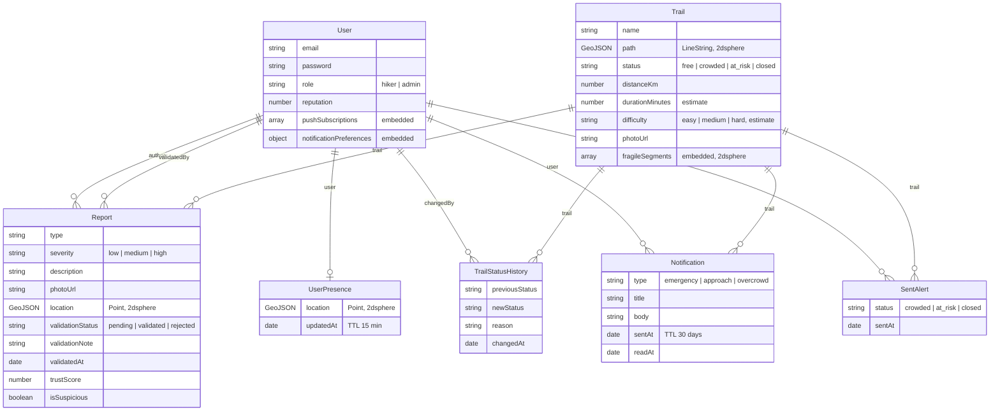

# Schema dati EcoTrail (MongoDB)

Diagramma delle collezioni definite finora, con le relazioni tra loro. Le frecce continue rappresentano un riferimento (`ObjectId` + `ref`, come una foreign key); i campi annidati (es. `path` dentro `Trail`, `pushSubscriptions` dentro `User`) sono documenti embedded, non collezioni a sé, non compaiono quindi come entità separate nel diagramma.

## Cosa rappresenta ogni collezione

### `User`
Identità e credenziali di chi usa l'app, sia escursionisti sia admin. Le subscription push e le preferenze di notifica restano embedded perché riguardano solo quell'utente, cambiano raramente e sono sempre lette insieme a lui.

| Campo | Tipo | A cosa serve |
|---|---|---|
| `email`, `password` | String | Credenziali di accesso (1.5); `password` è sempre un hash bcrypt, mai testo in chiaro |
| `role` | enum `hiker` / `admin` | Distingue escursionista da admin per i middleware di autorizzazione (1.5) |
| `reputation` | Number | Peso dell'utente nel calcolo di attendibilità di una sua segnalazione (4.3) |
| `pushSubscriptions[]` | array embedded | Uno per dispositivo registrato (telefono, PC...): dice al server dove recapitare le notifiche push (3.1) |
| `notificationPreferences` | object embedded | `radiusMeters` + `alertTypes`: filtra chi, tra gli utenti vicini a un evento, va davvero avvisato (3.5, 3.10) |

### `Trail`
Un sentiero reale: dove passa, come si chiama, in che stato è. È l'oggetto attorno a cui ruota l'intera app (mappa, segnalazioni, notifiche).

| Campo | Tipo | A cosa serve |
|---|---|---|
| `name` | String | Mostrato su mappa, popup e dashboard (1.8, 2.8) |
| `path` | GeoJSON LineString | Il tracciato disegnato da Leaflet e usato dalle query geografiche (`$geoWithin`, 1.7) |
| `status` | enum `free`/`crowded`/`at_risk`/`closed` | Colore/icona sulla mappa (1.8) e innesco delle notifiche quando cambia (2.7, 3.6, 3.7) |
| `distanceKm` | Number, opzionale | Lunghezza del sentiero in km, calcolata dalla geometria di `path`; mostrata nella sidebar dei sentieri (1.10) |
| `durationMinutes` | Number, opzionale | Tempo di percorrenza **stimato** in minuti (non ci sono dati di dislivello); mostrato nella sidebar |
| `difficulty` | enum `easy`/`medium`/`hard`, opzionale | Difficoltà **stimata** (i dati importati non hanno il tag OSM `sac_scale`); pallino colorato e etichetta nella sidebar |
| `photoUrl` | String, opzionale | URL di una foto del sentiero; per ora un placeholder generico, la sidebar mostra l'immagine solo se il campo esiste |
| `fragileSegments[]` | array embedded, sotto-geometrie proprie | Individuano i tratti su cui contare gli utenti attivi per il sovraffollamento (3.8), con indice geografico indipendente dal tracciato principale |

### `Report` 
Una segnalazione fatta da un escursionista: cosa ha visto, dove, con che foto, e il suo percorso di validazione da parte dell'admin.

| Campo | Tipo | A cosa serve |
|---|---|---|
| `author` | ref `User` | Chi ha inviato la segnalazione |
| `type` | enum (albero caduto, frana, allagamento...) | Cosa è stato segnalato (2.1) |
| `severity` | enum `low`/`medium`/`high` | Gravità del problema (2.1) |
| `description`, `photoUrl` | String | Dettagli facoltativi e foto allegata (2.1, 2.2) |
| `location` | GeoJSON Point | Dove si trova; usata per collegare al sentiero più vicino via `$near` e per mostrarla sulla mappa (2.1, 2.4) |
| `trail` | ref `Trail` | Il sentiero a cui è collegata |
| `validationStatus` | enum `pending`/`validated`/`rejected` | Percorso di revisione dell'admin (2.5, 2.9) |
| `validationNote` | String | Motivazione data dall'admin in fase di validazione/rifiuto (2.5) |
| `validatedBy`, `validatedAt` | ref `User`, Date | Chi ha revisionato e quando |
| `trustScore` | Number, default 0 | Cresce con conferme indipendenti di altri utenti; alimenta le soglie automatiche (4.3, 4.5) |
| `isSuspicious` | Boolean, default false | Segnala un pattern di abuso da un singolo utente; nasconde il report al pubblico ed esclude che faccia salire il trustScore di altri (4.4) |

### `TrailStatusHistory`
La traccia di "chi ha cambiato cosa e perché" su un sentiero. Separata da `Trail` perché cresce senza limite nel tempo, un documento per ogni cambio di stato, tenerla embedded avrebbe fatto crescere `Trail` indefinitamente e appesantito ogni singola lettura della mappa.

| Campo | Tipo | A cosa serve |
|---|---|---|
| `trail` | ref `Trail` | Quale sentiero è cambiato |
| `previousStatus`, `newStatus` | enum | Da cosa a cosa è cambiato |
| `reason` | String | Perché — mostrato come timeline nel pannello admin (2.8) |
| `changedBy` | ref `User` (admin) | Chi ha fatto il cambio |
| `changedAt` | Date | Quando — ordina la timeline ed è alla base dello "storico eventi" delle statistiche (4.6) |

### `UserPresence` 
La posizione attuale di un utente durante un'escursione. Separata da `User` perché si riscrive ogni pochi secondi/metri (dato "caldo"), a differenza di email/password/ruolo che non cambiano quasi mai. Un indice TTL cancella da solo il documento dopo 15 minuti di inattività, implementando gratis la regola "attivo solo se recente" (3.4) senza bisogno di controllarla a mano.

| Campo | Tipo | A cosa serve |
|---|---|---|
| `user` | ref `User`, unico | Un solo documento per utente, sempre sovrascritto |
| `location` | GeoJSON Point | Interrogata con `$nearSphere` per trovare utenti vicini a un evento (3.5) |
| `updatedAt` | Date, TTL 15 min | Il documento scompare da solo se l'utente smette di inviare la posizione |

### `Notification`
Le notifiche push effettivamente inviate, una per destinatario. Unica collezione con un campo `type` a discriminare lo scenario, così il centro notifiche dell'utente (3.10) e le statistiche (4.6) leggono la stessa fonte. Un indice TTL elimina le notifiche dopo 30 giorni: lo storico delle statistiche sulle notifiche copre al massimo gli ultimi 30 giorni. La notifica viene salvata anche se la push non parte (utente con le notifiche silenziate o senza sottoscrizione): le statistiche contano quindi le persone avvisate dal sistema, non le push effettivamente recapitate.

| Campo | Tipo | A cosa serve |
|---|---|---|
| `user` | ref `User` | A chi è stata mandata — per il centro notifiche dell'utente (3.10) |
| `type` | enum `emergency`/`approach`/`overcrowd` | Distingue lo scenario che l'ha generata |
| `trail` | ref `Trail`, opzionale | Sentiero a cui si riferisce, per il link cliccabile nella notifica (3.6) |
| `title`, `body`, `url` | String | Testo e destinazione della notifica |
| `sentAt` | Date, TTL 30 giorni | Quando è stata inviata; raggruppando per sentiero e minuto si ricava "quante persone sono state avvisate" (3.6, 4.6) |
| `readAt` | Date, default `null` | Quando l'utente l'ha letta |

### `SentAlert` 
Un flag di deduplica: evita di mandare la stessa allerta più volte alla stessa persona. Durante un'escursione la posizione arriva ogni pochi secondi — senza questo controllo, un utente fermo vicino a un sentiero chiuso riceverebbe la stessa notifica decine di volte.

| Campo | Tipo | A cosa serve |
|---|---|---|
| `user`, `trail`, `status` | ref, ref, enum | Indice unico sui tre insiemi: se esiste già un documento con questa combinazione, l'utente è già stato avvisato per questo stato di questo sentiero. Se lo stato cambia (es. torna `free` e poi ridiventa `at_risk`) la combinazione è nuova e l'avviso riparte, senza dover cancellare nulla (3.7) |
| `sentAt` | Date | Quando è stato inviato l'avviso |

## Note di progettazione

- Tutte le collezioni con dati geografici (`Trail.path`, `Trail.fragileSegments`, `Report.location`, `UserPresence.location`) hanno un indice 2dsphere, necessario per le query `$near`/`$geoWithin`/`$nearSphere`.
- GeoJSON vuole le coordinate come [longitudine, latitudine]

Schemi Mongoose corrispondenti: `server/src/models/*.js`.
